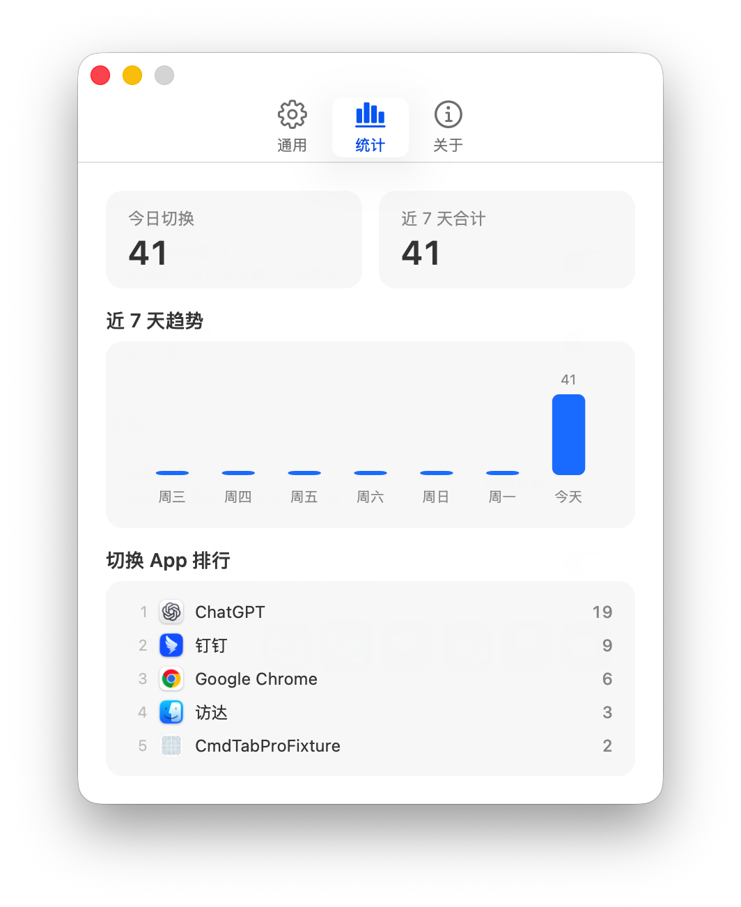

# Cmd Tab Pro

  

有些 macOS 应用按下 `Cmd+W` 后只关闭窗口，进程仍在运行。再次使用 `Cmd+Tab` 切回应用时，窗口却不会回来。

**Cmd Tab Pro** 保留系统原生 `Cmd+Tab`，切换到无窗口应用时自动唤回窗口，让应用切换更丝滑。

  
  

  <a href="https://github.com/areskts/cmd-tab-pro/releases/latest"><strong>下载最新版本</strong></a>
  · macOS 26+
  · Apple Silicon

## 功能亮点

- **保留原生体验**：不接管、不替换系统 `Cmd+Tab`，也不需要辅助功能、输入监控或屏幕录制权限。
- **自动唤回窗口**：切换到无窗口应用时，自动重新打开窗口并前置。
- **近 7 天统计**：展示每日切换趋势和切换最多的 5 个 App，可以随时清除。
- **常用设置集中管理**：支持登录时启动、浅色或深色主题，以及菜单栏图标显示。
- **三套应用图标**：可以在通用页面切换图标，应用会自动重新签名并重启。
- **便于排查问题**：关于页面可以复制诊断信息，不包含 App 名称和切换统计。

## 安装

从 [GitHub Releases](https://github.com/areskts/cmd-tab-pro/releases/latest) 下载 ZIP，解压后将 `CmdTabPro.app` 移入 `/Applications`。当前发布包使用 ad-hoc 签名且未经过 Apple 公证，首次打开可能被 Gatekeeper 阻止，请前往“系统设置 → 隐私与安全性”选择仍要打开。

从源码安装时，在项目目录运行：

    bash scripts/install.sh

安装脚本会为 macOS 26 构建 Apple Silicon arm64 二进制、生成 AppIcon.icns、启用 hardened runtime、进行 ad-hoc 签名、复制到 `/Applications` 并启动，不需要辅助功能权限。

## 使用

正常打开工具会显示主页面并常驻菜单栏。关闭主页面不会退出工具，再次打开 App 或从菜单选择“打开应用”即可恢复页面。

`Cmd+W` 关闭主页面但保持窗口自动唤回继续运行；`Cmd+Q` 完全退出 App。

菜单栏可以暂停功能、设置登录时启动、隐藏图标或退出。主页面也可以控制菜单栏图标是否显示；关闭后仍可重新打开 App 进入主页面并恢复图标。

统计记录普通 GUI 应用成为前台应用的次数，来源可能是 Cmd+Tab、Dock、Spotlight 或点击窗口。当前无权限方案无法区分具体切换来源。

界面主题支持跟随系统、浅色和深色，默认跟随系统并记住用户选择。

主页面分为“通用”“统计”“关于”三个页签。通用页面管理启动、主题、菜单栏和应用图标；统计页面展示最近 7 天的切换数据；关于页面提供诊断、清除统计和检查更新。

主窗口内容区固定为 420 × 460，当前版本不支持拖拽缩放或绿色按钮放大。检查更新只会打开 GitHub Releases，应用不会在后台联网。

应用图标切换适用于当前 ad-hoc 分发版本。确认切换后，辅助程序会替换 AppIcon.icns、重新签名并重启 Cmd Tab Pro；其他候选图标仍保存在 `Assets/IconOptions/Flat/`。

## 验证

安装并启动应用后运行正对照：

    bash Tests/Acceptance/run.sh 1

退出 Cmd Tab Pro 后运行负对照：

    bash Tests/Acceptance/run.sh 0

运行统计存储测试：

    bash Tests/Statistics/run.sh

## 边界

- Cmd+Q 已退出的应用不会出现在 Cmd+Tab 中，也不会由本工具启动。
- 工具不检查窗口数量，而是把是否需要创建窗口交给目标应用自己的 reopen 处理。
- 规范的 macOS 应用在已有窗口时只前置，在没有窗口时创建窗口。
- 少数不规范应用可能忽略 reopen，或把它解释为新建窗口。

## 数据与隐私

统计只保存在本机 UserDefaults，并自动删除 7 天前的数据。每条统计只包含日期、App 显示名称、Bundle ID 和次数，不记录窗口标题、文件内容、使用时长或键盘输入，也不会上传网络。复制诊断信息时不会包含 App 名称、切换次数或统计明细。

## 卸载

先在菜单栏关闭“登录时启动”并退出，再删除：

    /Applications/CmdTabPro.app

## 打包与下载

生成可上传到 GitHub Releases 的 ZIP 和 SHA-256 校验文件：

    bash scripts/package-release.sh

产物位于 `.build/release/`，仅支持 Apple Silicon Mac。打包固定使用默认方案 2，不会修改或重启本机已经安装的 Cmd Tab Pro。ZIP 使用 ad-hoc 签名且未经过 Apple notarization，因此从网络下载后首次打开可能被 Gatekeeper 阻止。用户可以在“系统设置 → 隐私与安全性”中选择仍要打开，然后再次确认。

GitHub Releases 可以直接托管这个 ZIP，其他人下载、解压并将 `CmdTabPro.app` 移入 `/Applications` 后即可使用。发布时应同时上传 `.sha256` 文件，并在发布说明中写明系统版本、芯片要求和首次打开方式。

## 源码与许可

Cmd Tab Pro 源码公开，采用 [PolyForm Noncommercial License 1.0.0](LICENSE)。你可以将本项目用于个人学习、研究、测试和其他非商业用途，也可以在许可证允许的范围内修改和分发代码。未经作者书面授权，不得将本项目或其衍生作品用于商业目的。

欢迎通过 GitHub Issues 反馈问题或提出建议，也欢迎提交 Pull Request。提交的贡献代码将使用与本项目相同的许可证。
