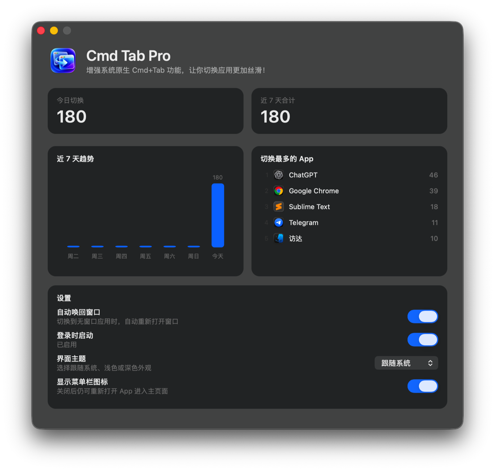

# Cmd Tab Pro

按下 `Cmd+W` 关闭最后一个窗口后，应用仍在运行，但再次使用 `Cmd+Tab` 时，窗口却不会回来？

**Cmd Tab Pro** 保留系统原生 `Cmd+Tab`，切换到无窗口应用时自动唤回窗口，让应用切换更丝滑。

  

  <a href="https://github.com/areskts/cmd-tab-pro/releases/latest"><strong>下载最新版本</strong></a>
  · macOS 26+
  · Apple Silicon

## 功能亮点

- **保留原生体验**：不接管、不替换系统 `Cmd+Tab`，也不需要辅助功能、输入监控或屏幕录制权限。
- **自动唤回窗口**：切换到无窗口应用时，自动重新打开窗口并前置。
- **近 7 天统计**：展示每日切换趋势和切换最多的 5 个 App，数据只保存在本机。
- **常用设置集中管理**：支持登录时启动、浅色或深色主题，以及菜单栏图标显示。

## 安装

在项目目录运行：

    bash scripts/install.sh

安装脚本会为 macOS 26 构建 Apple Silicon arm64 二进制、生成 AppIcon.icns、启用 hardened runtime、进行 ad-hoc 签名、复制到 /Applications 并启动，不需要辅助功能权限。

从 v0.1.0 手动升级时，请先退出并删除 `/Applications/Cmd Tab Pro.app`，再将新版 `CmdTabPro.app` 移入 `/Applications`。新版 Bundle ID 已调整为 `com.ares.cmd.tab`，原来启用过“登录时启动”的用户需要重新开启一次。

## 使用

正常打开工具会显示主页面并常驻菜单栏。关闭主页面不会退出工具，再次打开 App 或从菜单选择“打开 Cmd Tab Pro…”即可恢复页面。

菜单栏可以暂停功能、设置登录时启动、隐藏图标或退出。主页面也可以控制菜单栏图标是否显示；关闭后仍可重新打开 App 进入主页面并恢复图标。

统计记录普通 GUI 应用成为前台应用的次数，来源可能是 Cmd+Tab、Dock、Spotlight 或点击窗口。当前无权限方案无法区分具体切换来源。

界面主题支持跟随系统、浅色和深色，默认跟随系统并记住用户选择。

主窗口固定为 760 × 720，当前版本不支持拖拽缩放或绿色按钮放大。

## 验证

安装并启动应用后运行正对照：

    bash Tests/Acceptance/run.sh 1

退出 Cmd Tab Pro 后运行负对照：

    bash Tests/Acceptance/run.sh 0

运行统计存储测试：

    bash Tests/Statistics/run.sh

## 边界

- Cmd+Q 已退出的应用不会出现在 Cmd+Tab 中，也不会由本工具启动。
- 工具不检查窗口数量，而是把是否需要创建窗口交给目标应用自己的 reopen 处理。
- 规范的 macOS 应用在已有窗口时只前置，在没有窗口时创建窗口。
- 少数不规范应用可能忽略 reopen，或把它解释为新建窗口。

## 数据与隐私

统计只保存在本机 UserDefaults，并自动删除 7 天前的数据。每条统计只包含日期、App 显示名称、Bundle ID 和次数，不记录窗口标题、文件内容、使用时长或键盘输入，也不会上传网络。

## 卸载

先在菜单栏关闭“登录时启动”并退出，再删除：

    /Applications/CmdTabPro.app

## 打包与下载

生成可上传到 GitHub Releases 的 ZIP 和 SHA-256 校验文件：

    bash scripts/package-release.sh

产物位于 `.build/release/`，仅支持 Apple Silicon Mac。ZIP 使用 ad-hoc 签名且未经过 Apple notarization，因此从网络下载后首次打开可能被 Gatekeeper 阻止。用户可以在“系统设置 → 隐私与安全性”中选择仍要打开，然后再次确认。

GitHub Releases 可以直接托管这个 ZIP，其他人下载、解压并将 `CmdTabPro.app` 移入 `/Applications` 后即可使用。发布时应同时上传 `.sha256` 文件，并在发布说明中写明系统版本、芯片要求和首次打开方式。

## 开源准备

项目不依赖第三方库，构建和安装流程都在仓库内。发布到公开仓库前还需要选择许可证；推荐 MIT，但不会在未经确认的情况下自动添加。

当前部署目标为 macOS 26.0，仅支持 Apple Silicon arm64。当前发布包采用 ad-hoc 签名，接受用户手动信任的 Gatekeeper 提示；如果以后需要双击即开，再增加 Developer ID 签名和 Apple notarization。

Bundle ID：`com.ares.cmd.tab`。
