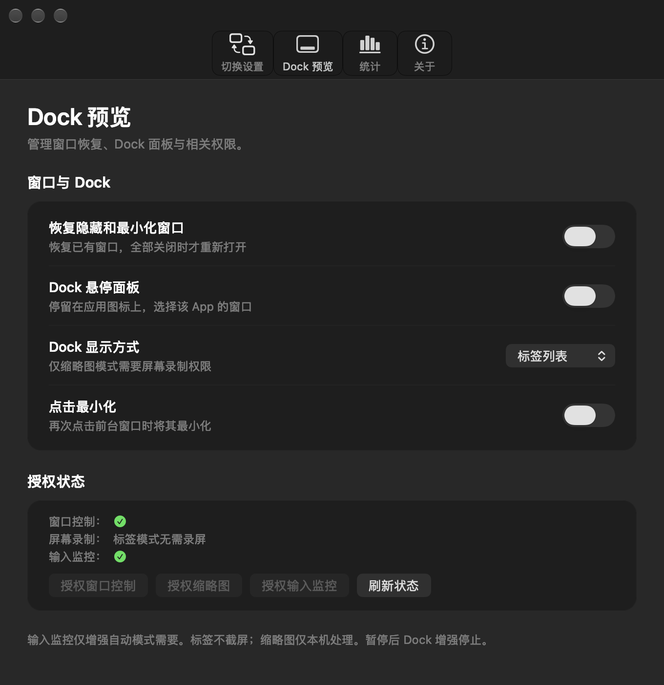
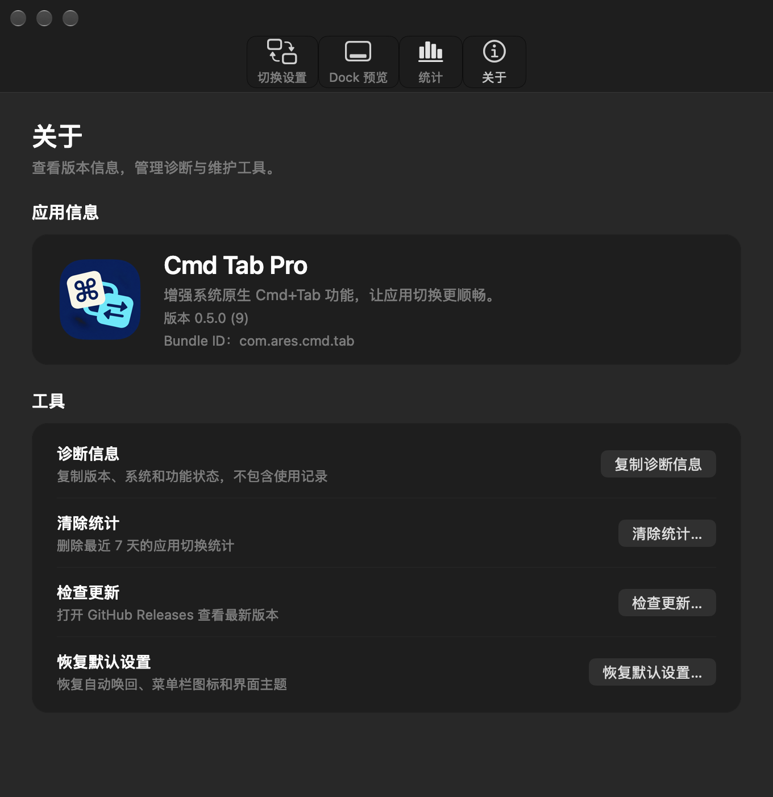

# Cmd Tab Pro

<p align="center">
  
</p>

**切到了 App，窗口却没有回来？**

在 macOS 上，按 `Cmd+W` 关闭最后一个窗口后，应用进程可能仍在运行，但再次 `Cmd+Tab` 切回时，只切到了应用，屏幕上却没有窗口。窗口被最小化时，也可能需要再去 Dock 找一次。

**Cmd Tab Pro** 为系统原生 `Cmd+Tab` 补上窗口唤回，并提供 **Dock 悬停预览、窗口选择和点击最小化**，减少切到 App 以后再找窗口的操作。继续使用系统切换器，无需学习另一套快捷键。

<p align="center">
  <a href="https://github.com/areskts/cmd-tab-pro/releases/latest"><strong>下载最新版本</strong></a>
  · macOS 26+
  · Apple Silicon（arm64）
</p>

<p align="center">
  
  
</p>

## v0.5.0 更新

- **设置页改版**：更宽松的布局，按“切换设置、Dock 预览、统计、关于”分组；原生玻璃工具栏和 Dock 悬浮面板适配 macOS 26 / 27，支持跟随系统、浅色和深色外观。
- **恢复已有窗口**：可选恢复隐藏或最小化的窗口；确认应用没有窗口时，才请求重新打开。
- **Dock 悬停预览**：直接停留在 Dock 图标上查看窗口，支持标签列表和窗口缩略图两种方式，点击即可切到对应窗口。
- **点击最小化**：再次点击前台 App 的 Dock 图标，或预览中的当前窗口，最小化一个普通窗口。
- **后台按需出现**：开机启动时安静运行，关闭设置窗口后功能继续生效；暂停时同时停止 Dock 增强。
- **权限与稳定性**：集中展示窗口控制、屏幕录制、输入监控三项授权；修复切换到列表后面 App 时漏掉窗口唤回，以及访达只有桌面时无法唤回的问题。

## 窗口会怎样恢复

| 当前状态 | Cmd Tab Pro 的处理 |
| --- | --- |
| 最后一个窗口已关闭，App 仍在运行 | 请求 App 重新显示或创建窗口，具体内容由目标 App 决定 |
| App 被隐藏 | 开启窗口恢复后，前置已有窗口 |
| 所有窗口都已最小化 | 开启窗口恢复后，恢复最近使用的一个窗口 |
| 部分窗口最小化，仍有普通窗口可用 | 沿用普通窗口，保留其他窗口的最小化状态 |
| 窗口在其他桌面或全屏 Space | 视为已有窗口，遵循系统激活行为，不因此新建窗口或移动窗口 |
| App 已通过 `Cmd+Q` 退出 | 不主动启动它；后续启动仍由 macOS 处理 |

窗口状态无法可靠读取时，不将它视为“窗口已关闭”。重新打开窗口也不代表恢复已经关闭的文档，文档恢复能力由目标 App 提供。

## 两种唤回模式

**增强自动模式**需要输入监控权限，被动识别一次完整的 `Cmd+Tab` 操作。它不拦截或修改系统快捷键，不保存键盘输入；新的键鼠操作会取消尚未执行的恢复，避免延迟请求抢回焦点。

**兼容模式**的基础唤回无需额外权限。它根据 App 激活通知工作，因此 Dock、Spotlight 或点击窗口也可能触发唤回。输入监控不可用时，自动回退到兼容模式。

点击桌面也会激活访达，所以兼容模式不自动打开访达窗口。需要通过 `Cmd+Tab` 唤回无窗口的访达时，请使用增强自动模式。

## Dock 预览与点击最小化

在“Dock 预览”页中，窗口恢复、Dock 悬停面板和点击最小化可以独立开启，默认关闭。

- **标签列表**：停留在 Dock 图标上即可查看窗口标题，无需屏幕录制权限。
- **窗口缩略图**：在设置中切换显示方式，额外授予屏幕录制权限后查看画面。图片按比例铺满卡片图像区域，边缘可能裁剪，标题单独显示；无法取得画面时显示图标和标题。
- **点击选择窗口**：悬停本身不激活 App，点击面板中的窗口才前置或恢复它。
- **点击最小化**：普通单击前台 App 的 Dock 图标，或点击预览中的当前前台窗口，最小化一个普通窗口；后台、隐藏或最小化的目标窗口先恢复。全屏窗口、修饰键点击、长按和拖拽保留系统行为。

支持底部、左侧和右侧 Dock，悬浮面板保持在目标显示器内。最小化或跨桌面窗口能否提供缩略图，取决于系统接口。

## 安装与权限

1. 从 [GitHub Releases](https://github.com/areskts/cmd-tab-pro/releases/latest) 下载 ZIP 并解压。
2. 将 `CmdTabPro.app` 放入 `/Applications`，然后打开。
3. 在“切换设置”选择唤回模式，在“Dock 预览”按需开启增强功能。

发布包使用 **ad-hoc 签名，未经过 Apple 公证**。首次打开可能被 Gatekeeper 阻止，请在“系统设置 → 隐私与安全性”中选择仍要打开。当前仅提供 Apple Silicon 版本。

| 功能 | 所需权限 |
| --- | --- |
| 兼容模式的基础窗口唤回 | 无 |
| 增强自动模式 | 输入监控 |
| 恢复隐藏和最小化窗口 | 辅助功能（窗口控制） |
| Dock 标签列表、窗口选择、点击最小化 | 辅助功能（窗口控制） |
| Dock 窗口缩略图 | 辅助功能 + 屏幕录制 |

“Dock 预览 → 授权状态”集中显示三项系统权限，已授权显示绿色圆形勾选。输入监控按钮可直接打开对应系统设置页，授权后点击“刷新状态”。部分 macOS 版本将辅助功能显示为“设备控制和数据访问”。后台启动不会反复弹出权限请求。

**升级提示**：公开发布的 ad-hoc 包更新或切换图标后，macOS 可能要求重新授权。如果开关已开启但功能仍不可用，请在系统设置中重新添加或重开对应授权。

## 日常使用

- 正常打开 App 会显示设置窗口；开机启动时保持后台运行。
- `Cmd+W` 关闭设置窗口，功能继续运行；`Cmd+Q` 完全退出。
- 菜单栏图标默认隐藏，可在“切换设置”中开启，用于暂停、打开设置或退出。
- 支持跟随系统、浅色和深色主题，以及三套应用图标。
- 统计页展示最近 7 天的切换趋势和最常使用的 5 个 App；关于页提供诊断信息、清除统计、恢复默认设置和检查更新。
- “检查更新”打开 GitHub Releases，应用不会在后台联网检查更新。

统计记录 App 成为前台应用的次数，来源包含 `Cmd+Tab`、Dock、Spotlight 和点击窗口，代表应用切换次数。

<p align="center">
  
  
</p>

## 数据与隐私

统计只保存在本机，自动删除 7 天前的数据。每条统计仅包含日期、App 显示名称、Bundle ID 和次数，不记录文件内容、窗口标题、使用时长或键盘输入，不上传网络。复制的诊断信息不包含 App 名称或统计明细。

开启窗口与 Dock 增强后，程序按需读取窗口列表、标题和状态。标签列表不截屏；缩略图只在面板显示期间按需获取，仅在内存中缓存，不上传或保存截图文件。材质和控件遵循系统的透明度、对比度与动态效果偏好。

## 从源码构建

项目使用纯 Swift / AppKit，无第三方依赖、SwiftUI 或 Interface Builder。需要 macOS 26+、Apple Silicon 和可提供对应 SDK 的 Apple 命令行开发工具。

```sh
git clone https://github.com/areskts/cmd-tab-pro.git
cd cmd-tab-pro
bash scripts/install.sh
```

安装脚本构建 arm64 应用、生成三套 ICNS、启用 hardened runtime，签名后安装到 `/Applications` 并启动。未配置证书时使用 ad-hoc 签名。

### 开发时保留授权

反复编译时，可以创建一次固定本机代码签名证书，再正常安装：

```sh
bash scripts/setup-local-signing.sh
bash scripts/install.sh
```

此方案无需付费 Apple 开发者会员。脚本在登录钥匙串创建专用代码签名身份，复用 `~/.config/cmd-tab-pro/signing-identity` 中的指纹，仅为代码签名设置用户级信任；临时私钥文件会清理。也可以通过 `CMD_TAB_PRO_SIGN_IDENTITY` 指定已有证书指纹。

首次从 ad-hoc 迁移到固定证书后需要重新授权一次。后续构建与图标切换沿用同一签名身份；证书或私钥不可用、身份变化或签名失败时停止更新，保留原 App。请保留钥匙串中的证书、私钥和指纹配置。

固定本机签名仅用于本地开发，不提供 Apple 公证。公开发布脚本显式使用 ad-hoc，不使用本机私钥签署发布包。

## 验证与发布打包

界面、窗口恢复、Dock 交互与签名的用例及实机验收范围见 [回归记录](REGRESSION.md)。按模块运行：

```sh
bash Tests/Windows/run.sh
bash Tests/UI/run.sh
bash Tests/Windows/integration.sh --reopen-only
bash Tests/Windows/integration.sh --finder-only
bash Tests/Windows/integration.sh --controller-only
bash Tests/Signing/run.sh
```

真实窗口测试需要测试进程具备辅助功能权限；访达定向测试在已有访达窗口时跳过，不会关闭已有窗口。完整自动回归入口为 `bash Tests/run.sh`；真实键盘、多显示器、跨桌面和登录启动仍需相应实机验收。

生成发布 ZIP 和 SHA-256 校验文件：

```sh
bash scripts/package-release.sh
```

产物位于 `.build/release/`。打包固定使用默认方案 2 图标，不覆盖或重启本机已安装的 App。GitHub Releases 同时提供 ZIP 和 `.sha256` 文件。

## 卸载

先关闭“开机自启动”并退出 App，然后删除 `/Applications/CmdTabPro.app`。

## 源码与许可

源码公开，采用 [PolyForm Noncommercial License 1.0.0](LICENSE)，允许许可证范围内的个人学习、研究、测试、修改及其他非商业用途。未经作者书面授权，不得将本项目或其衍生作品用于商业目的。

欢迎通过 GitHub Issues 反馈问题或提交 Pull Request。贡献代码使用与本项目相同的许可证。
